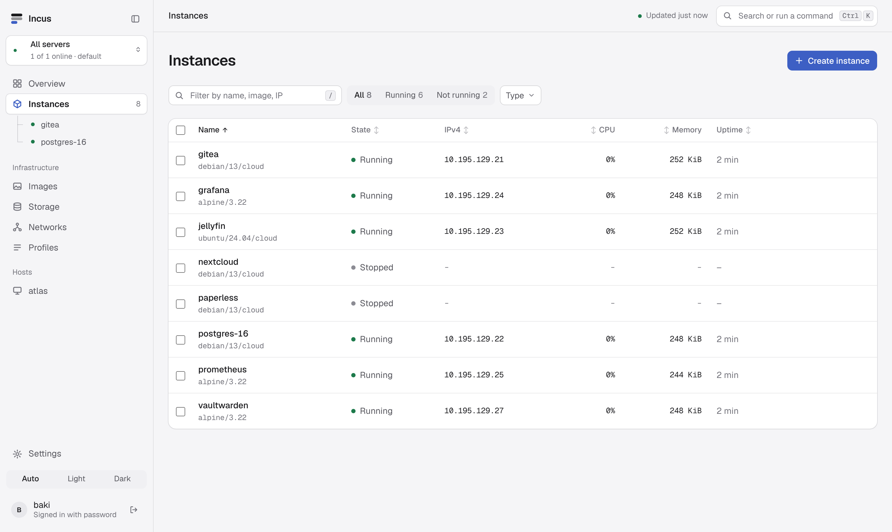

<div align="center">
  
  <h1>Incus WebUI</h1>
  <p>A web interface for <a href="https://linuxcontainers.org/incus/">Incus</a> and IncusOS. One binary, no database, runs as a container on the server it manages.</p>

  <a href="https://github.com/baki2001/Incus-WebUI/releases/latest"></a>
  <a href="https://github.com/baki2001/Incus-WebUI/actions/workflows/ci.yml"></a>
  <a href="LICENSE"></a>
</div>

<br>

<picture>
  <source media="(prefers-color-scheme: dark)" srcset="docs/images/instances-dark.png">
  
</picture>

> [!NOTE]
> This is a test release (0.5). It works against real servers, but expect rough edges and report them in [issues](https://github.com/baki2001/Incus-WebUI/issues).

## Features

- An overview you can arrange: pick the tiles you want and where they go. The layout is saved per account.
- Instances: create, start, stop, pause, snapshot, restore and delete, with filters that show counts per value and live in the URL. Bulk actions skip instances they should not touch. Rename, copy, move, publish as an image, and set snapshot expiry. Pin the ones you use most to the sidebar.
- Create instances from an image server, an image already on the server, an OCI registry, or an ISO you uploaded.
- Images: pull from an image server or OCI registry and keep them cached, with aliases and auto update.
- Networks, ACLs and IPAM; storage pools, volumes, buckets and custom ISOs; profiles and projects with limits. Each one can be created, edited as a form or YAML, and deleted.
- Backups to a directory or an S3 bucket, by hand or on a daily schedule that keeps a number of daily and weekly backups. Each backup has a checksum that restores check, and a schedule can test-restore its backups every week. See [Backups](docs/backups.md).
- Import from Proxmox (VM and container backup files) and from Docker Compose files. A preview shows what each part becomes and what doesn't carry over; a failed import cleans up after itself. See [Import](docs/migrate.md).
- Roles per server and project (viewer, operator, manager, admin), for local users, SSO users and SSO groups, and an audit log of every change and sign-in. See [Roles and the audit log](docs/roles.md).
- A week of CPU, memory, network and disk history for every instance and host, kept by the UI itself.
- WireGuard tunnels for remote access to your networks, a homelab to VPS link with port publishing, or monitoring an existing tunnel. See [WireGuard tunnels](docs/tunnels.md).
- Operations and warnings, so you can see what Incus is doing and what it noticed.
- Terminal, console and files for every instance, each on its own tab:
  - Terminal opens a new shell inside the instance, the same as `incus exec`.
  - Console shows the instance's own screen, the same as `incus console`. VMs get a graphic mode (SPICE) and a text mode. Use it when the network or the OS inside is broken.
  - File Explorer browses, uploads, downloads and edits files, and deletes folders recursively.
  - The terminal keeps running when you switch tabs, and has a key row on phones.
- Hardware settings as a form (CPU, memory, disks, network cards, port forwards, autostart, snapshot schedule), with a YAML view and a diff to review before anything is applied. If someone else changed the instance meanwhile, you see the conflict before saving.
- Several Incus servers in one place. Connect a server by pasting a trust token.
- Sign in with a password, with single sign-on (OIDC), or both. Signing out ends the session, changing a password ends the user's other sessions, and repeated failed logins lock out that user and address for a while.
- Updates from the UI, for the UI itself and for Incus (IncusOS, or Debian and Ubuntu with a small helper).
- Light and dark mode, plus a server-wide theme with your own accent colour.
- A command menu on <kbd>Ctrl</kbd> <kbd>K</kbd> to search instances, networks, storage, images and more, and to run instance actions.

The layout works on phones, and errors stay on screen until you dismiss them.

## Install

On a Debian or Ubuntu machine that runs Incus, this sets the UI up as a container called `incus-webui`:

```sh
curl -fsSL https://raw.githubusercontent.com/baki2001/Incus-WebUI/main/install/incus-instance.sh | sudo bash
```

It prints the address and a one-time setup code. Open the address, enter the code and pick a username and password. Updates install from Settings, Updates and about.

The [install guide](docs/install.md) explains each step, how to do it by hand, and the other ways to run it: as a plain binary on any Linux machine, or as an OCI image.

## Upgrading to 0.5

Nothing changes for existing users: everyone keeps full access until an admin sets up roles under Settings, Users and roles. Update from Settings, Updates and about, or install again with the script above.

## How it works

The binary serves the interface and forwards API calls to each Incus server over HTTPS, using its own client certificate. Your browser never talks to Incus directly and never holds an Incus certificate. Settings, users and the list of servers live in one `config.yaml` file.

Long tasks such as backups and imports run in the binary, not in the browser, so they keep going when you close the tab. Metric history and the audit log are files in the data folder next to `config.yaml`.

## Development

You need Go 1.26 and Node 22.

```sh
make build                       # builds the UI and the binary
./incus-webui --data ./data      # serves https://localhost:8443
```

For UI work, keep the binary running and start `npm run dev` in `web/`. Vite forwards API calls to port 8443.

## License

[Apache 2.0](LICENSE)
